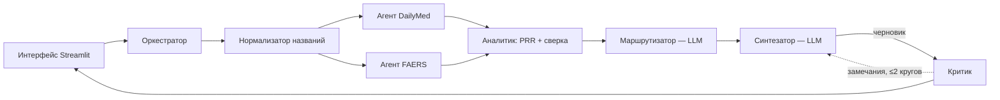

# Досье безопасности препарата

Мультиагентное приложение сравнивает **официальную инструкцию FDA** (DailyMed) с **реальными сообщениями о нежелательных реакциях** (FAERS) и выделяет реакции, о которых сообщают непропорционально часто, но которых нет в инструкции, — **кандидатов в сигнал**.

> Учебный проект курса «Программная инженерия мультиагентных систем в клинической медицине». Не медицинская рекомендация. FAERS — спонтанные сообщения: они не доказывают причинно-следственную связь.

## Практическое задание №2. MCP

В левом меню приложения выберите **«MCP-инструменты»**. Досье по DailyMed и FAERS открывается в разделе **«Досье»**.

```bash
./run.sh
```

Для первого запуска нужны Python 3.11 или 3.12 и интернет для установки зависимостей. Скрипт создаёт `.venv`, поднимает отдельный MCP-сервер на порту 8000 и запускает Streamlit на порту 8501. Откройте [приложение](http://127.0.0.1:8501). Для расчётов на двух локальных серверах достаточно ноутбука. Для поиска FDA или PubMed нужен интернет. Для запуска обеих частей из другой папки вызывайте `/путь/к/drug-safety/run.sh`.

| Источник | Как клиент общается с сервером | Что доступно |
|---|---|---|
| Локальный процесс | `stdio`, стандартные ввод и вывод дочернего процесса | ИМТ, площадь поверхности тела, шкала Глазго и каталог границ |
| Локальный порт 8000 | SSE для ответов, HTTP POST для отправки запросов | Все три предыдущих калькулятора, рСКФ, QTc и каталог границ |
| Arca Life Sciences | Streamable HTTP, удалённый сервер | Публичный поиск по FDA и PubMed, без API-ключа |

### Один вызов по шагам

1. **Клиент** открывает соединение и отправляет `initialize`. Сервер возвращает согласованную версию протокола и возможности.
2. Клиент запрашивает `tools/list`. В ответе есть имена инструментов и `inputSchema` — описание обязательных полей, типов, единиц и диапазонов. Интерфейс строит поля из этой схемы.
3. При нажатии кнопки клиент отправляет `tools/call`. Например, для `bmi` аргументы — `weight_kg: 70` и `height_cm: 175`. Сервер проверяет вход, вызывает формулу и отвечает значением **22,86 кг/м²**.
4. Инспектор показывает реальные сообщения с обеих сторон. Поле `id` связывает запрос с его ответом. Уведомление `notifications/initialized` не требует ответа и поэтому не имеет `id`.

| Где смотреть в коде | Зачем |
|---|---|
| `mcp_tools/calculators.py` | Формулы, типы, единицы, допустимые диапазоны и ссылки на методики |
| `mcp_tools/server.py` | Публикация функций как инструментов MCP и запуск нужного транспорта |
| `mcp_tools/client.py` | Инициализация, список, вызов, повторы при сбое SSE, журнал сообщений и общий таймаут внешнего вызова до 12 секунд |
| `mcp_tools/screen.py` | Выбор инструмента, поля из схемы, карточка результата, кэш внешнего сервиса и инспектор |
| `.cursor/mcp.json` | Пример подключения этих же серверов из Cursor при открытии корня репозитория |

Сетевой клиент приводит числовые строки к нужным типам, включая десятичную запятую. Явное значение по умолчанию есть, например, у метода коррекции QT. Если измерение не введено, интерфейс просит его указать.

### Репетиция защиты

1. **stdio.** Откройте ИМТ, введите массу 60 кг и рост 160 см. Покажите результат **23,44 кг/м²**, формулу и ссылку. В инспекторе найдите `tools/call` и ответ с тем же `id`.
2. **SSE.** Переключитесь на «Локальный сервер · SSE» и повторите расчёт ИМТ с теми же числами. Покажите подпись подключения в инспекторе, тот же вызов `bmi` и тот же результат. В `mcp_tools/client.py` видно, что клиент обращается к локальному адресу `http://127.0.0.1:8000/sse`. Для демонстрации расширенного каталога можно также выбрать «Кардиология» → QTc.
3. **Внешний MCP.** Выберите поиск PubMed. Запрос `warfarin amiodarone interaction`, число результатов 2. Покажите статьи и исходные ссылки из ответа. Для демонстрации подходят вымышленные ситуации и публичные названия препаратов.

Перед защитой повторите все три вызова. При проблемах с интернетом сохранённая трасса успешного внешнего вызова показывает, как прошёл обмен во время репетиции.

### Пять вопросов преподавателя

- **MCP и REST/OpenAPI.** REST задаёт способ работы с HTTP-ресурсами, OpenAPI описывает HTTP API. В MCP клиент по общему протоколу получает каталог инструментов и их схемы и вызывает их одним типом запроса. MCP поддерживает HTTP и стандартные потоки процесса.
- **Почему логи в stderr.** В режиме stdio stdout читает клиент и ожидает по одному JSON-RPC-сообщению на строку. Обычный `print()` добавит посторонний текст. Диагностику отправляем в stderr.
- **Что в JSON-RPC.** Запрос содержит `jsonrpc`, `id`, `method`, при необходимости `params`. Для `initialize` в параметрах идут версия, возможности и сведения о клиенте. Для `tools/call` — имя и аргументы инструмента. Ответ несёт тот же `id` и `result` или `error`.
- **SSE и stdio.** Stdio удобен, когда приложение запускает собственный процесс. Сетевой SSE-сервер может принимать подключения нескольких клиентов, но возможны сетевые задержки и разрывы, а при сетевом доступе нужно управлять правами.
- **Как защитить расчёт от ошибок LLM.** Считать в детерминированной функции. На сервере проверять типы, границы и единицы, при пропусках просить исходные данные, а значения из карты связывать с их источником и предъявлять врачу для проверки.

## Задача

Один вопрос — «насколько безопасен препарат или сочетание препаратов?» — и два источника, которые отвечают на него с разных сторон:

| Источник | Что даёт | Доступ |
|---|---|---|
| DailyMed (инструкции FDA) | что **ожидается**: противопоказания, предупреждения, взаимодействия, особые группы | openFDA `/drug/label` |
| FAERS | что **наблюдается**: сообщения о нежелательных реакциях | openFDA `/drug/event` |

## Архитектура



| Паттерн (лекция 3) | Где |
|---|---|
| Цепочка | нормализация → источники → аналитик → синтез |
| Параллельное выполнение | агенты DailyMed и FAERS работают одновременно |
| Маршрутизация | LLM выбирает разделы инструкции под вопрос пользователя |
| Рефлексия | критик проверяет сводку (ссылки, числа, формулировки) и возвращает на доработку |

Порядок шагов задан кодом (workflow): поведение предсказуемо и проверяемо. Модель принимает решения в маршрутизаторе и синтезаторе. Без ключа LLM приложение работает: разделы выбирают правила, сводку собирает код.

## Как считается сигнал

Таблица 2×2 по всем сообщениям FAERS:

|  | реакция | нет реакции |
|---|---|---|
| препарат | a | b |
| остальные | c | d |

$$PRR = \frac{a/(a+b)}{c/(c+d)}$$

Реакция выделяется по критериям Эванса: `a ≥ 3`, `PRR ≥ 2`, `χ² ≥ 4` (χ² с поправкой Йейтса). Если она выделяется и не найдена в разделах безопасности инструкции — это кандидат в сигнал.

## Ограничения

- FAERS: спонтанные сообщения, есть дубли и неполные данные, причинность не доказана.
- Только препараты рынка США; вводить международные названия латиницей (частые русские названия переводятся словарём или LLM).
- Сверка с инструкцией по словам: синонимы могут не распознаваться.

## Запуск

```bash
pip install -r requirements.txt
streamlit run app.py
```

Ключ Gemini (необязательно) — в `.streamlit/secrets.toml` локально или в **Settings → Secrets** на Streamlit Cloud:

```toml
GEMINI_API_KEY = "..."
```

## Структура

```
app.py               интерфейс
orchestrator.py      порядок шагов и журнал (трасса)
agents/
  openfda.py         HTTP-клиент: тайм-ауты, повторы
  normalizer.py      название → международное (INN)
  label_agent.py     агент DailyMed
  faers_agent.py     агент FAERS
  analyst.py         PRR, сверка с инструкцией, взаимодействия
  router.py          маршрутизатор разделов
  synthesizer.py     синтезатор и критик (рефлексия)
  llm.py             вызов Gemini
```

## Развитие

RxNorm — нормализация торговых названий; российские источники (ГРЛС, КР Минздрава); PubMed — проверка сигналов литературой; VigiAccess — мировые данные.
