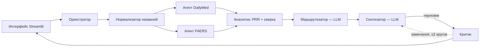

# Досье безопасности препарата

Мультиагентное приложение сравнивает **официальную инструкцию FDA** (DailyMed) с **реальными сообщениями о нежелательных реакциях** (FAERS) и выделяет реакции, о которых сообщают непропорционально часто, но которых нет в инструкции, — **кандидатов в сигнал**.

> Учебный проект курса «Программная инженерия мультиагентных систем в клинической медицине». Не медицинская рекомендация. FAERS — спонтанные сообщения: они не доказывают причинно-следственную связь.

## Задача

Один вопрос — «насколько безопасен препарат или сочетание препаратов?» — и два источника, которые отвечают на него с разных сторон:

| Источник | Что даёт | Доступ |
|---|---|---|
| DailyMed (инструкции FDA) | что **ожидается**: противопоказания, предупреждения, взаимодействия, особые группы | openFDA `/drug/label` |
| FAERS | что **наблюдается**: сообщения о нежелательных реакциях | openFDA `/drug/event` |

## Архитектура



| Паттерн (лекция 3) | Где |
|---|---|
| Цепочка | нормализация → источники → аналитик → синтез |
| Параллельное выполнение | агенты DailyMed и FAERS работают одновременно |
| Маршрутизация | LLM выбирает разделы инструкции под вопрос пользователя |
| Рефлексия | критик проверяет сводку (ссылки, числа, формулировки) и возвращает на доработку |

Порядок шагов задан кодом (workflow): поведение предсказуемо и проверяемо. Модель принимает решения в маршрутизаторе и синтезаторе. Без ключа LLM приложение работает: разделы выбирают правила, сводку собирает код.

## Как считается сигнал

Таблица 2×2 по всем сообщениям FAERS:

|  | реакция | нет реакции |
|---|---|---|
| препарат | a | b |
| остальные | c | d |

$$PRR = \frac{a/(a+b)}{c/(c+d)}$$

Реакция выделяется по критериям Эванса: `a ≥ 3`, `PRR ≥ 2`, `χ² ≥ 4` (χ² с поправкой Йейтса). Если она выделяется и не найдена в разделах безопасности инструкции — это кандидат в сигнал.

## Ограничения

- FAERS: спонтанные сообщения, есть дубли и неполные данные, причинность не доказана.
- Только препараты рынка США; вводить международные названия латиницей (частые русские названия переводятся словарём или LLM).
- Сверка с инструкцией по словам: синонимы могут не распознаваться.

## Запуск

```bash
pip install -r requirements.txt
streamlit run app.py
```

Ключ Gemini (необязательно) — в `.streamlit/secrets.toml` локально или в **Settings → Secrets** на Streamlit Cloud:

```toml
GEMINI_API_KEY = "..."
```

## Структура

```
app.py               интерфейс
orchestrator.py      порядок шагов и журнал (трасса)
agents/
  openfda.py         HTTP-клиент: тайм-ауты, повторы
  normalizer.py      название → международное (INN)
  label_agent.py     агент DailyMed
  faers_agent.py     агент FAERS
  analyst.py         PRR, сверка с инструкцией, взаимодействия
  router.py          маршрутизатор разделов
  synthesizer.py     синтезатор и критик (рефлексия)
  llm.py             вызов Gemini
```

## Развитие

RxNorm — нормализация торговых названий; российские источники (ГРЛС, КР Минздрава); PubMed — проверка сигналов литературой; VigiAccess — мировые данные.
